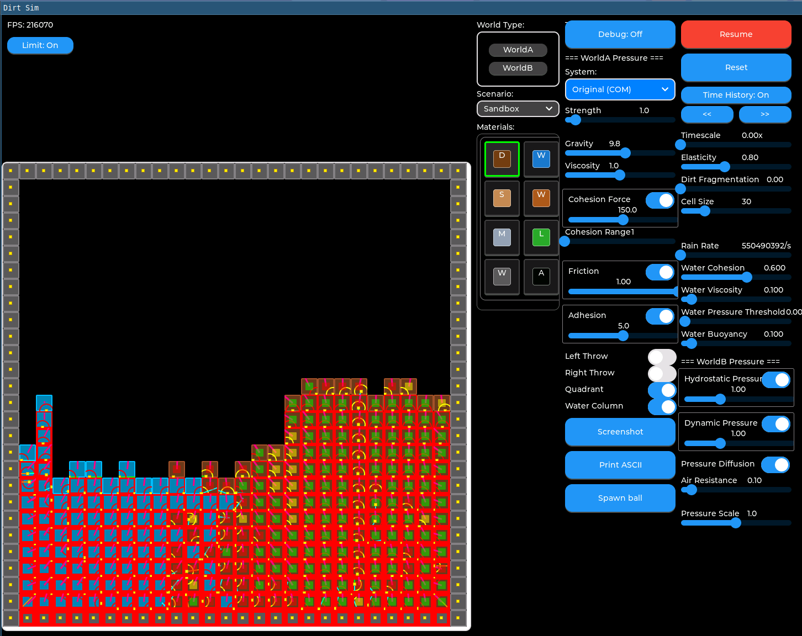
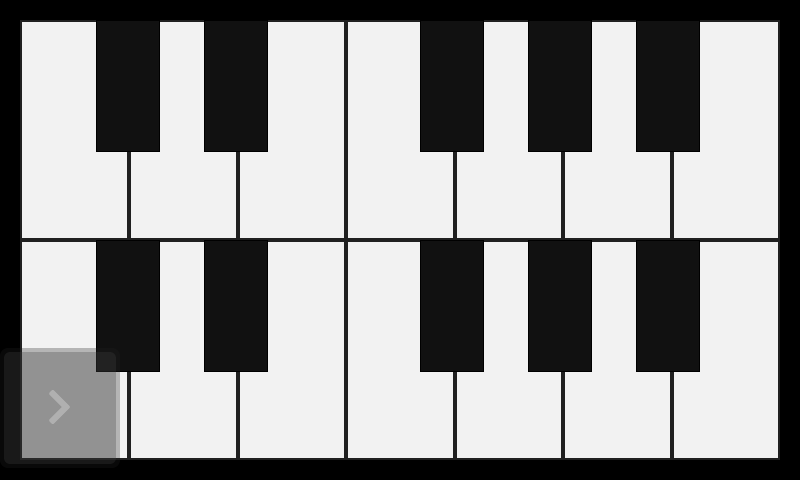
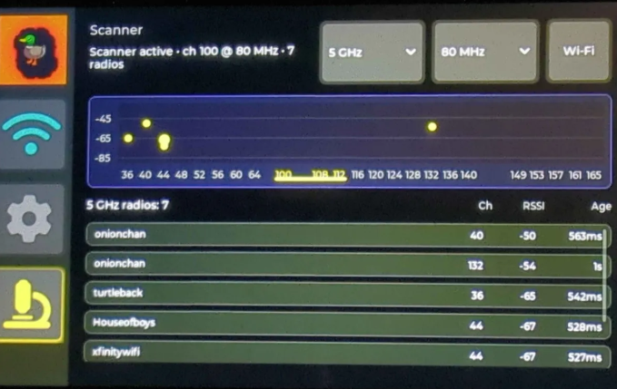

## Project Overview

DirtSim is a grid/cell-based playground for experimenting with various ideas.

It attempts to simulate both fluid and rigid body dynamics.

It has sensory and motor-based artificial life forms, injectable into most scenarios.
The life forms have either hard coded or trainable neural networks for brains.

It also has a very nice clock mode, just hacked in because why not make use of the weird grid physics.
This is probably the most practical use of this application - as a clock with various strange effects and events (marquee effects, rain, melting digits, glowing digits, parkour duck, etc).

In the below image you can see a "duck" lifeform, holding a flash light, jumping across the floor beneath the clock.



There is also a polyphonic digital synth.


It also has a monitor-mode based wifi channel scanner.


It has an integrated NES emulator, allowing for training neural nets on whatever games you choose to supply.

Plus more... dirtsim was my playground for a while, so there are various other full to half baked things in here, such as:
* A web server, allowing remote access via h266-based streaming video.
* A NES state space searcher, finding optimal input streams for games.
* A fractal viewer.

It runs on Linux X86 under X11, wayland, and framebuffer.

It also designed as an embedded application, running great on Raspberry Pi 4 and 5.

## Target Hardware

* Raspberry Pi 4 or 5
* MPI4008 4" HDMI touchscreen (480x800) or HyperPixel 4.0 DPI (480x800)
* Unified image auto-detects hardware
* Also runs natively on linux/x86

## Repository Structure

```
dirtsim/
├── apps/              # Main simulation application
│   ├── src/server/    # Headless physics simulation (WebSocket API :8080)
│   ├── src/ui/        # LVGL display client (WebSocket API :7070)
│   └── src/cli/       # Command-line tool for control, testing, benchmarking
└── yocto/             # Yocto layer for building Pi images
```

## Quick Start

```bash
cd apps
make debug                           # Build
./build-debug/bin/cli run-all        # Run server + UI
./build-debug/bin/cli functional-test canTrain  # Smoke test (requires running UI/server)
```

## Documentation

| Document | Location | Description |
|----------|----------|-------------|
| Application docs | `README.md` | Build, run, test, architecture |
| Architecture | `apps/design_docs/Architecture.md` | System overview and components |
| Physics system | `apps/design_docs/GridMechanics.md` | Pressure, friction, cohesion, etc. |
| Coding conventions | `coding_convention.md` | Style guidelines |
| CLI reference | `apps/src/cli/README.md` | Command-line interface |
| Yocto deployment | `yocto/` | Yocto layer for building Pi images |

## Remote Deployment

```bash
# Deploy from workstation (Yocto-based full system).
cd yocto
npm run yolo -- --hold-my-mead             # Build + deploy + reboot
npm run yolo -- --clean-all --hold-my-mead # Full rebuild
npm run yolo -- --target <dirtsim-hostname> --fast --hold-my-mead # Fast deploy

# SSH to device.
ssh <dirtsim-hostname>

# Check service.
ssh <dirtsim-hostname> "systemctl status dirtsim-server"
ssh <dirtsim-hostname> "journalctl -u dirtsim-server -f"

# Verify WebSocket endpoints via CLI on device.
ssh <dirtsim-hostname> "dirtsim-cli server StatusGet"
ssh <dirtsim-hostname> "dirtsim-cli ui StatusGet"
```
